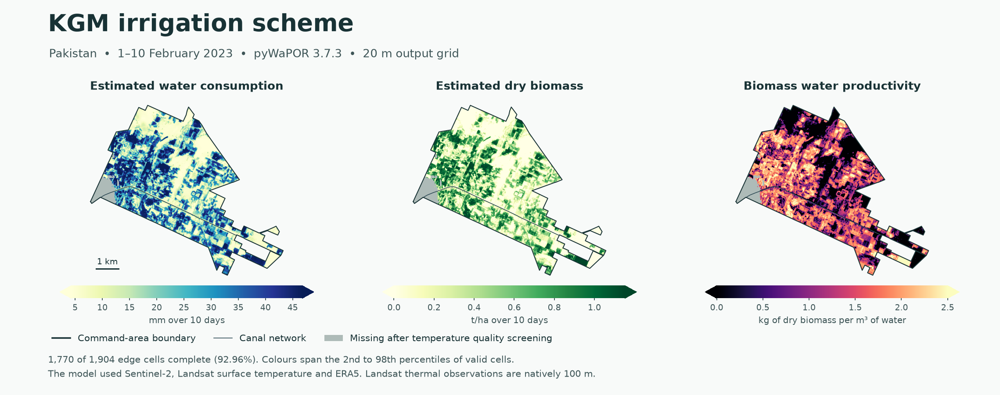

# RIPA irrigation performance pilot

The KGM pilot uses pyWaPOR 3.7.3 to estimate actual evapotranspiration and interception (AETI) and net primary production (NPP) for 1–10 February 2023. The outputs are clipped to the irrigation command area on a 20 m UTM grid. A companion analysis uses published WaPOR Level 3 rasters to check seasonal aggregation and boundary coverage at Wad Helal, Sudan.

[数据来源与计算方法（中文）](docs/RIPA_KGM_Pilot_Methods.docx) · [Data sources and calculation methods (English)](docs/RIPA_KGM_Pilot_Methods_EN.docx)



## Run KGM with the archived inputs

From the repository root, create the model environment, point pyWaPOR to the staged NetCDF files and run the model.

```sh
conda create -p ./work/kgm/model -c conda-forge python=3.12 pywapor=3.7.3

conda run --no-capture-output -p ./work/kgm/model python pilot/prepare_kgm_public_inputs.py \
  --aoi data/kgm/kgm_pywapor_extent.geojson --folder data/kgm/inputs --reuse-staged

conda run --no-capture-output -p ./work/kgm/model python pilot/run_kgm.py \
  --aoi data/kgm/kgm_pywapor_extent.geojson --start 2023-02-01 --end 2023-02-10 \
  --folder work/kgm/runs --configuration-json data/kgm/inputs/kgm_public_inputs.json \
  --output work/kgm/results
```

The input folder includes the exact observations used in the pilot and a [source manifest](data/kgm/inputs/kgm_input_sources.json) with scene IDs and data URLs. The setup command writes the local pyWaPOR configuration. The model writes its native NetCDF to the run directory. The export writes the three 20 m raster layers and coverage tables to the results directory. The [command area](data/kgm/boundaries/command_area.geojson) and [canal network](data/kgm/boundaries/canal_network.geojson) are available as geometry-only GeoJSONs.

To download the inputs again, use the commands in the [data preparation notes](pilot/README.md#public-input-kgm-pilot-for-110-february-2023). Those scripts use the dates and scene footprints for this KGM pilot. The separate pyWaPOR default download configuration requires Copernicus Data Space, Climate Data Store and NASA Earthdata access.

## KGM results

| Measure | Result for 1–10 February 2023 |
| --- | ---: |
| Command-area cells with AETI and NPP | 67,487 of 69,664 (96.875%) |
| Complete cells within 20 m inside the boundary | 1,770 of 1,904 (92.962%) |
| Edge cells outside the model footprint | 0 |
| Mean AETI over complete cells | 22.77 mm |
| Mean estimated dry biomass over complete cells | 0.374 t/ha |
| Dry biomass per unit of water consumed, ratio of totals | 1.64 kg/m³ |

The 134 missing edge cells coincide with the 5 February Landsat temperature uncertainty mask. All exceed the pilot's 3 K threshold. Landsat's thermal sensor samples at 100 m. The 20 m reporting grid combines that thermal input with finer optical data and other inputs through pyWaPOR.

- [20 m GeoTIFF](results/kgm/kgm_dekads_20m.tif) with AETI, estimated dry biomass and water productivity.
- [Native model NetCDF](results/kgm/kgm_pywapor_native.nc) with AETI, transpiration, evaporation, interception, reference ET, relative root-zone moisture and NPP.
- [Coverage table](results/kgm/kgm_edge_coverage.csv), [Landsat quality audit](results/kgm/kgm_landsat_mask_audit.json) and [run summary](results/kgm/kgm_summary.json).

Run the Landsat audit against the published raster to reproduce the missing-cell counts.

```sh
conda run --no-capture-output -p ./work/kgm/model python pilot/audit_kgm_temperature.py \
  --aoi data/kgm/kgm_pywapor_extent.geojson --raster results/kgm/kgm_dekads_20m.tif \
  --output work/kgm/kgm_landsat_mask_audit.json
```

## Wad Helal reference analysis

The 2022–23 wheat-season analysis uses 21 dekads of WaPOR Level 3 AETI and NPP from the Gezira tile. The crop season covers 1 October 2022 through 30 April 2023. The run produced the [seasonal raster](results/wad-helal/wad_helal_seasonal_20m.tif), [wheat parcel table](results/wad-helal/wad_helal_fields.csv) and [edge check](results/wad-helal/wad_helal_edge_coverage.json). The [reference analysis instructions](pilot/README.md#wad-helal) download the source rasters and regenerate the seasonal maps and parcel statistics. [IHE Delft WaPOR course](https://github.com/wateraccounting/WaPORMOOC/blob/main/3_Python_for_WaPOR/N04_Seasonal_Aggregation_and_WP.ipynb)
